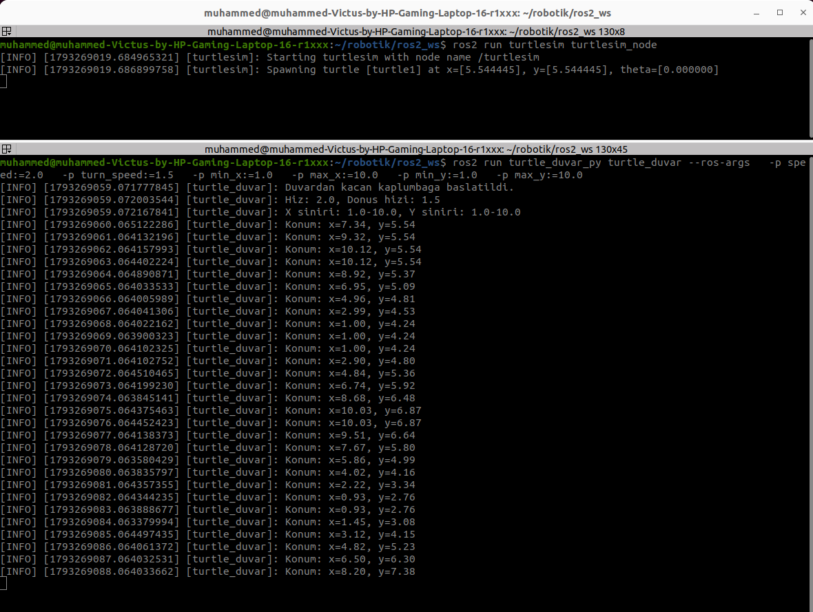
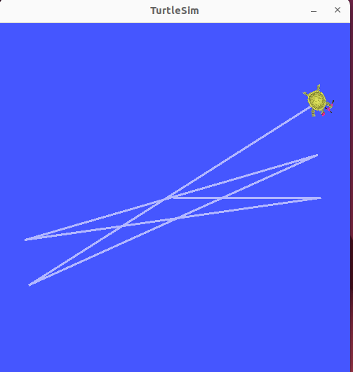

# ROS 2 Duvarlardan Kaçan Kaplumbağa

## Proje Hakkında

Bu proje, **ROS 2 Humble** ve Python kullanılarak geliştirilen, Turtlesim simülasyonunda duvarlardan kaçan bir kaplumbağa uygulamasıdır.

Uygulama, kaplumbağanın konumunu sürekli takip eder. Kaplumbağa belirlenen koordinat sınırlarının dışına çıktığında simülasyon alanının merkezine doğru yönelir ve hareketine devam eder. Konum bilgileri saniyede bir terminale yazdırılır.

Ek olarak ileri hareket hızı, dönüş hızı ve X/Y koordinat sınırları ROS 2 parametreleriyle ayarlanabilir.

## Kullanılan Teknolojiler

- Ubuntu 22.04
- ROS 2 Humble
- Python 3
- `rclpy`
- `geometry_msgs`
- `turtlesim`
- `colcon`
- Git ve GitHub

## Paket Yapısı

```text
turtle_duvar_py/
├── screenshots/
│   ├── terminal.png
│   └── turtlesim.png
├── turtle_duvar_py/
│   ├── __init__.py
│   └── turtle_duvar.py
├── resource/
│   └── turtle_duvar_py
├── test/
│   ├── test_copyright.py
│   ├── test_flake8.py
│   └── test_pep257.py
├── package.xml
├── setup.cfg
├── setup.py
├── .gitignore
└── README.md
```

## Çalışma Mantığı

1. `turtle_duvar` düğümü, `/turtle1/pose` konusu üzerinden kaplumbağanın konumunu ve yön açısını alır.
2. Kaplumbağanın hareketi `/turtle1/cmd_vel` konusu üzerinden kontrol edilir.
3. Kaplumbağa belirlenen koordinat sınırları içindeyken ileri doğru hareket eder.
4. X veya Y koordinatı tanımlanan sınırların dışına çıktığında hedef olarak simülasyon alanının merkezi belirlenir.
5. `atan2` fonksiyonuyla merkeze doğru hedef yön açısı hesaplanır.
6. Kaplumbağa, mevcut yönüyle hedef yönü arasındaki açı farkına göre döner. Açı farkı yeterince küçüldüğünde ileri hareketine devam eder.
7. Konum bilgileri her saniye terminale yazdırılır.
8. Hareket ve sınır değerleri ROS 2 parametreleriyle belirlenebilir.

### Varsayılan Parametreler

| Parametre | Varsayılan değer | Açıklama |
|---|---:|---|
| `speed` | `2.0` | İleri hareket hızı |
| `turn_speed` | `1.5` | Açısal dönüş hızı |
| `min_x` | `1.0` | X koordinatının alt sınırı |
| `max_x` | `10.0` | X koordinatının üst sınırı |
| `min_y` | `1.0` | Y koordinatının alt sınırı |
| `max_y` | `10.0` | Y koordinatının üst sınırı |

> **Not:** Algoritma sınırın dışına çıkıldığında dönüş yapar; sınırın hemen içindeyken önleyici bir manevra hesaplamaz.

## Ekran Görüntüleri

### Terminal Çıktısı

Düğümün başlatılması, parametreler ve kaplumbağanın konum bilgileri:



### Turtlesim Simülasyonu

Kaplumbağanın simülasyondaki hareket izi:



## Kurulum ve Çalıştırma

### 1. Gereksinimler

Bu proje Ubuntu 22.04 ve ROS 2 Humble kurulu bir ortam için hazırlanmıştır.

ROS 2 ortamını etkinleştirin:

```bash
source /opt/ros/humble/setup.bash
```

Gerekli araçları yükleyin:

```bash
sudo apt update
sudo apt install -y git python3-colcon-common-extensions python3-rosdep
```

`rosdep` daha önce başlatılmadıysa ilk kullanımda şu komutları çalıştırın:

```bash
sudo rosdep init
rosdep update
```

> `sudo rosdep init` komutunu daha önce çalıştırdıysanız yeniden çalıştırmanız gerekmez.

### 2. Depoyu Klonlama

Workspace ve `src` klasörlerini oluşturun:

```bash
mkdir -p ~/robotik/ros2_ws/src
cd ~/robotik/ros2_ws/src
```

Depoyu klonlayın:

```bash
git clone https://github.com/canonacan/turtle_duvar_py.git
```

### 3. Bağımlılıkları Yükleme

Workspace kök dizinine geçin ve ROS 2 ortamını etkinleştirin:

```bash
cd ~/robotik/ros2_ws
source /opt/ros/humble/setup.bash
```

Paket bağımlılıklarını yükleyin:

```bash
rosdep install --from-paths src --ignore-src -r -y
```

### 4. Paketi Derleme

```bash
cd ~/robotik/ros2_ws
source /opt/ros/humble/setup.bash
colcon build --packages-select turtle_duvar_py
source install/setup.bash
```

Derleme başarılı olduğunda paket çalıştırılabilir hâle gelir.

### 5. Turtlesim Simülasyonunu Başlatma

Birinci terminali açın:

```bash
source /opt/ros/humble/setup.bash
ros2 run turtlesim turtlesim_node
```

Turtlesim penceresi açılır. Bu terminali açık bırakın.

### 6. Kaplumbağa Düğümünü Başlatma

İkinci terminali açın:

```bash
cd ~/robotik/ros2_ws
source /opt/ros/humble/setup.bash
source install/setup.bash
ros2 run turtle_duvar_py turtle_duvar
```

Kaplumbağa ileri hareket etmeli, belirlenen koordinat sınırlarının dışına çıktığında merkeze yönelmeli ve konum bilgileri terminalde görünmelidir.

### 7. Parametrelerle Çalıştırma

Düğümü farklı hız ve koordinat sınırlarıyla başlatabilirsiniz:

```bash
ros2 run turtle_duvar_py turtle_duvar --ros-args \
  -p speed:=3.0 \
  -p turn_speed:=1.5 \
  -p min_x:=2.0 \
  -p max_x:=9.0 \
  -p min_y:=2.0 \
  -p max_y:=9.0
```

Bu örnekte ileri hareket hızı `3.0`, dönüş hızı `1.5` olur. X ve Y koordinat sınırları `2.0–9.0` aralığına ayarlanır.

Çalışan düğümün parametrelerini listelemek için başka bir terminalde:

```bash
source /opt/ros/humble/setup.bash
ros2 param list /turtle_duvar
```

Belirli parametrelerin değerlerini kontrol etmek için:

```bash
ros2 param get /turtle_duvar speed
ros2 param get /turtle_duvar min_x
ros2 param get /turtle_duvar max_x
```

> Parametreler düğüm başlatılırken okunur. Mevcut uygulamada çalışma sırasında `ros2 param set` ile değiştirilen değerler hareket algoritmasına otomatik olarak uygulanmaz. Farklı değerler kullanmak için düğümü yeni parametrelerle yeniden başlatın.

### 8. ROS 2 Konularını Kontrol Etme

Aktif konuları listeleyin:

```bash
source /opt/ros/humble/setup.bash
ros2 topic list
```

Kaplumbağanın konum bilgilerini görüntüleyin:

```bash
ros2 topic echo /turtle1/pose
```

Hareket komutlarını görüntüleyin:

```bash
ros2 topic echo /turtle1/cmd_vel
```

Düğüm bağlantılarını grafik olarak görüntülemek için:

```bash
sudo apt install -y ros-humble-rqt-graph
ros2 run rqt_graph rqt_graph
```

### 9. Uygulamayı Durdurma

Çalışan düğümleri durdurmak için ilgili terminal penceresinde `Ctrl + C` tuşlarına basın.

## Beklenen Çıktı

Düğüm başlatıldığında terminalde aşağıdakine benzer mesajlar görülür:

```text
[turtle_duvar]: Duvardan kacan kaplumbaga baslatildi.
[turtle_duvar]: Hiz: 2.0, Donus hizi: 1.5
[turtle_duvar]: X siniri: 1.0-10.0, Y siniri: 1.0-10.0
[turtle_duvar]: Konum: x=7.34, y=5.54
```

Konum değerleri kaplumbağanın hareketine göre değişir; yukarıdaki değerler örnektir.

## ROS 2 Düğümü ve Konuları

- **Düğüm:** `/turtle_duvar` — konumu takip eder ve hareket kararlarını verir.
- **Abone olunan konu:** `/turtle1/pose` — kaplumbağanın konum ve yön bilgisini sağlar.
- **Yayınlanan konu:** `/turtle1/cmd_vel` — doğrusal ve açısal hız komutlarını taşır.
- **Simülasyon düğümü:** `/turtlesim` — kaplumbağa simülasyonunu çalıştırır.

## GitHub Deposu

Kaynak kodu ve ekran görüntüleri:

[https://github.com/canonacan/turtle_duvar_py](https://github.com/canonacan/turtle_duvar_py)
